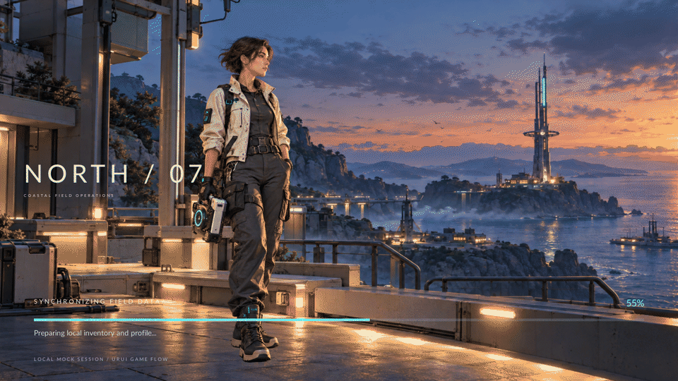

# URUI

URUI 使用 HTML/CSS 描述 Unity 游戏界面的结构、布局、皮肤和动画，通过 C# 查询节点、更新数据及处理输入。当前版本 `0.8.0-preview.1`，程序集 `URUI.Runtime`。HTML/CSS 支持范围以 [HtmlCssSupport.json](Documentation~/HtmlCssSupport.json) 为准。

## 文档导航

| 要完成的工作 | 阅读文档 |
| --- | --- |
| 安装包、配置 Unity 与原生插件 | [安装](Documentation~/INSTALL_ZH.md) |
| 运行样例、创建第一个页面 | [快速开始](Documentation~/QUICK_START_ZH.md) |
| 加载页面、查询/创建节点、操作层级 | [Document 与 Element API](Documentation~/API_ZH.md) |
| 按钮、输入框、滑块、下拉框、列表 | [控件使用](Documentation~/CONTROLS_ZH.md) |
| 默认外观、图片按钮与状态反馈 | [默认控件与作者皮肤](Documentation~/DEFAULT_CONTROLS_ZH.md) |
| 点击、指针捕获、键盘及组合串 | [输入与事件](Documentation~/EVENTS_ZH.md) |
| CSS 更新、计算样式、动画播放与时钟 | [样式与动画](Documentation~/STYLES_ANIMATION_ZH.md) |
| 图片、字体、租约、重载和释放 | [生命周期与资源](Documentation~/LIFECYCLE_ZH.md) |
| 自定义绘制、效果扩展、提交和视频 | [渲染扩展与媒体](Documentation~/RENDERING_ZH.md) |
| 查类型、完整签名、默认参数及继承关系 | [接口声明参考](Documentation~/REFERENCE_ZH.md) |
| 判断平台、输入和性能验证范围 | [支持范围](Documentation~/LIMITATIONS_ZH.md)、[插件清单](Documentation~/PLUGINS.json) |
| 后续方向与代码规范 | [路线图](Documentation~/ROADMAP_ZH.md)、[代码约定](Documentation~/CODE_STYLE_ZH.md) |

## 推荐从 Game Flow 开始

Package Manager → URUI → Samples → **Game Flow** → Import，打开导入目录中的 `GameFlow.unity` 并进入 Play Mode。菜单 **Tools > URUI > Open Game Flow Sample** 也会导入并打开场景。安装包本身不会自动导入样例。

样例展示加载、模拟登录、主页、背包、设置和排行榜，登录及排行使用本地 mock。HTML/CSS、图片、字体、脚本与场景均随包提供。标准导入目录为 `Assets/Samples/URUI/<包版本>/Game Flow`，以 Unity 实际路径为准。包内 `Samples~/Game Flow` 是源码，Assets 目录是导入副本。见 [Game Flow 说明](Samples~/Game%20Flow/README.md)。

动图为 Unity Editor 实际运行录制，不是 Player 验收。Hello URUI、Element Playground 与 Runtime Controls 可分别用于学习最小接入、节点操作和类型化控件。

## 核心使用关系

一个活动 `URUI.Hosting.Surface` 统一管理视口、时钟、输入和绘制；多个 `URUI.Documents.Document` 各自拥有 DOM、样式和资源。通过 `document.Q<T>()` 查询，或 `document.Create<T>()` 创建同文档节点。原始输入入口为 `document.Surface.Input`，节点操作在 Unity 主线程完成。

Core 不内置业务数据绑定。FUI 的窗口、导航与绑定由独立适配包接入；普通 Unity 组件也可以直接使用 Core。可选 [URUI.Effect](../com.fujisheng.urui.effect/README.md) 提供效果控制器、预设、粒子与表面处理，Core 不依赖该包。

普通几何按透明混合依赖合批，每批最多绑定 8 张原纹理，不制作图集或复制图片。纹理预算、颜色域、裁剪、变换、自定义绘制和图层会影响批次；效果可能产生额外绘制及 RenderTexture。具体性能需在目标项目和设备测量。

## 环境与发布范围

主要验证环境为 Unity **6000.3.22f1 / macOS ARM64 / Metal**，包含 Built-in、项目 URP 接入和相应 IL2CPP 回归 Player。当前协议为 **ABI11 / render-plan8 / style4 / effect7 / filter3 / animation1**，正式 C 导出集合由头文件与二进制核对生成。各平台构建、静态审计和实际运行状态分别记录在[插件清单](Documentation~/PLUGINS.json)。

使用 MainCamera、Input Manager (Old/Both) 或自行注入输入。真实系统 IME、移动软键盘及无障碍边界见[支持范围](Documentation~/LIMITATIONS_ZH.md)。图片借用完整常驻 mip0 的 Texture2D，字体需提供包含所需字形的可读字节资源。

项目许可见 [LICENSE.md](LICENSE.md)，第三方许可见 [Third Party Notices](Third%20Party%20Notices.md) 与 `Documentation~/Licenses/`。
