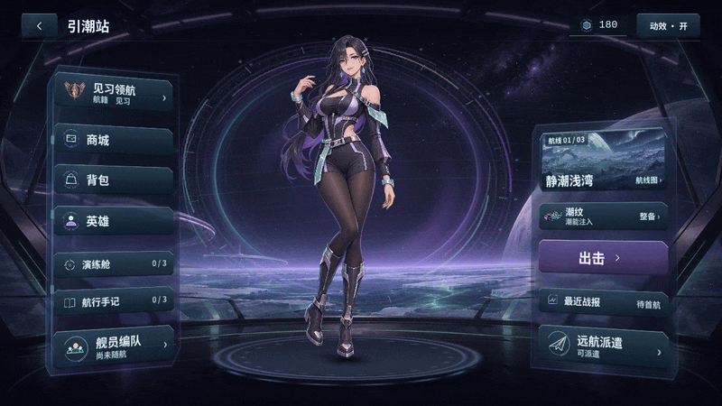

# Tideglass Beacon

[中文](README_ZH.md)

Tideglass Beacon was made entirely by AI, from interface design and code to original art, animation, and sound. This recording shows the sample running in Unity.

Open the repository's `SampleProject` in Unity 6000.3.22f1. Choose **Tools → URUI → Open Tideglass Beacon Sample** and enter Play Mode in `Tideglass.unity`. For a Built-in project, import **URUI → Samples → Tideglass Beacon** from Package Manager.

A new visitor starts at the station with 180 crystals. Select the sector photograph to open the chart and inspect targets, trial mechanics, rewards and best times. The shoal teaches energy and finishers, the belt has two mirror shells to break with the second ability, and the eclipse rewards alternating basic abilities. Lighting a beacon opens the next route. From the result sheet you can return to the station or open the chart. The flight log tracks clear counts and personal bests and pays each completed commission once.

The loadout bench stores two flight plans. Pair a module with a once-per-sortie order. Selecting a locked module opens its shop offer and returning restores the draft. Three practice courses use the equipped plan and record independent personal bests. A successful sortie produces a flight report with elapsed time, casts, actual damage by skill and order use. Open the matching exercise directly from that report. Live routes award crystals and unlock the next beacon. Practice keeps a separate best time.

The bridge passport shows the worn title and career rank. Each distinct beacon, completed drill and signed survey region contributes one merit. Complete all nine to earn the station's top rank. Eligible titles can be worn on the bridge.

Appoint an escort in the crew roster. Navigator Tinglan adds 12 starting charge, engineer Chiheng adds 12 damage to the second ability, and observer Xianzhou adds 28 finisher damage. The observer joins after the first beacon. Pilot rehearsal, drills and live combat use the selected crew bonus.

Use the dispatch console to send one available officer to survey, salvage or observe. Its three routes take 35, 65 and 95 seconds. A matching specialty earns a bonus. The escort and survey officer occupy separate posts. Travel uses the local clock and continues when the application closes. Sign the return docket to receive crystals, or recall a crew member early to forfeit that payout. Signing the first docket opens the outer route.

Select a module slot, drag or scroll its projection, or use the arrow keys to inspect equipment. Drag the pilot display to tilt the halo. Cast with the pointer or keys `1`, `2` and `3`, and issue the flight order with `4`. Hover over a crew portrait to tilt the framed card. Moving away lets it settle. Press `Esc` to return and `F1` for rendering statistics. The top-right control reduces motion. Currency, purchases, flight plans, crew, dispatched routes, titles, reports, practice records and redeemed commissions persist in the application's PlayerPrefs.

A macOS Player build uses the native bridge for the selected architecture. Choose **Apple silicon** or **Intel 64-bit** in the macOS build profile.

## URUI implementation

- Each side of the bridge mounts its station controls on one continuous refracting glass pane. All 14 controls have a fixed hit area and a single beveled face. URUI maps the pointer into local coordinates to tilt the keycap and move its reflection. A press moves the cap back in depth. The cap texture lets the scene show through while its lettering and icons stay opaque.
- Each optical pane captures and blurs its backdrop with `backdrop-filter`. The document's `tideglass-lens` effect offsets samples in panel coordinates. The host draws labels and controls afterwards.
- A dedicated document plays multitrack `SequencePlayer` transitions. Loadout drawers engage and release, the pilot lens closes as an iris, report sheets slide into their reader, and a targeting gate admits pilots to the range. Launch and return have different star trails. The scene changes under full cover. The combat clock and input start once the view is clear.
- Ability cooldowns use circular alpha masks and `Image.FillMode.Radial360`; a rim signals recovery. URUI Effect adds a wave display for finisher charge and synchronized impact particles. Reduced motion keeps the charge level, readiness states and damage legible.

The character and environmental plates are original ImageGen artwork. Interface graphics and audio were made for the sample. The Noto Sans SC subset and its license are in `Resources/URUI/Tideglass/Fonts`.
