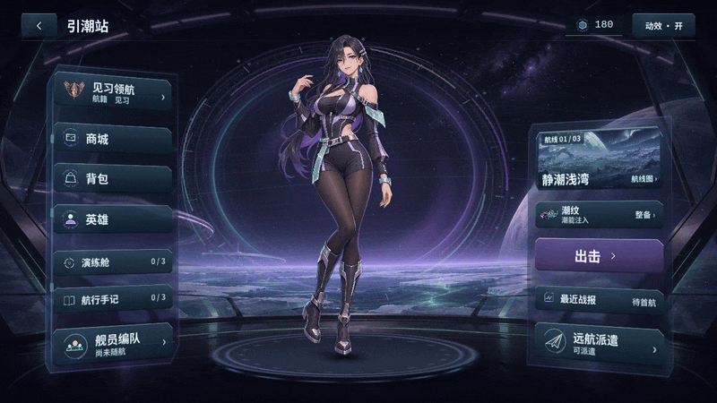

# 潮汐信标

《潮汐信标》完全由 AI 制作，涵盖界面设计、代码、原创美术、动效和音效。下方动图录自 Unity 实际运行画面。

用 Unity 6000.3.22f1 打开仓库的 `SampleProject`，选择 **Tools → URUI → Open Tideglass Beacon Sample**，在 `Tideglass.unity` 中进入 Play Mode。Built-in 工程可以从 Package Manager 导入 **URUI → Samples → Tideglass Beacon**。

游客首次抵达引潮站时持有 180 潮晶。点击右侧航区照片打开航线图，可查看目标、战斗机制、报酬和最快用时。出击后，静潮浅湾教你蓄能释放潮鸣，碎镜星环需要裂光剥除镜壳，长夜食海奖励交替施放基础技能。点亮信标会开放下一条航线，结算页可以直接前往航线图。航行手记记录每处信标的点亮次数和最快用时，达成委托后可单独领取潮晶。

战术整备台可以保存两套出击预案，每套组合一个模组和一道舰令。点选尚未持有的模组可以去商城查看价格，返回时会保留正在搭配的预案。演练舱有蓄能终结、剥除镜壳、交替连携三个课目，使用当前预案，可重试并记录各自的最快成绩。实战结算会写入最近战报，可以查看各技能的施放次数、实际伤害、通关用时和舰令使用情况，也可以直接进入对应课目重练。正式航行奖励潮晶并解锁下一航区。演练单独记录成绩。

大厅左上角的航籍牌展示当前航阶和佩戴的称号。点亮不同信标、达标不同演练、签收不同派遣航区的回执，各自贡献一项功绩。集齐九项可晋升站务长。满足授勋条件后可自行佩戴称号。

在大厅左下角的舰员编队任命随航。汀岚让出击时的潮能增加 12，赤衡让裂光多造成 12 点伤害。首次点亮信标后，观测官弦昼报到，可以让潮鸣多造成 28 点伤害。英雄预演、演练和正式航行都采用当前随航配置。

右下角的远航派遣可派一位待命舰员执行工作。三个航区的往返用时分别为 35、65 和 95 秒，匹配专长可获得额外潮晶。派遣期间该舰员占用一个岗位，可以同时让其他舰员随主角出击。关掉游戏后航程仍按本机时间推进。归港后手动签收回执到账，提前召回会放弃该次报酬。首次签收会开放暗侧听潮。

商城和背包通过点击、拖动投影、滚轮或左右方向键切换模组。拖动英雄展示区可转动角色背后的光环。在舰员编队中，将鼠标移到立绘上可倾转整张卡片，移开后归正。试炼支持点击与数字键 `1`、`2`、`3` 施放技能，`4` 下达本航次的一次性舰令。用 `Esc` 返回，`F1` 查看渲染统计，右上角可精简动效。货币、模组、预案、舰员任命、派遣、称号、战报、演练成绩和委托进度自动保存在当前应用的 PlayerPrefs。

导出 macOS Player 时，在 macOS 构建配置中按目标机器选择 **Apple silicon** 或 **Intel 64-bit**，使 Unity 带上相应架构的原生桥接库。

## URUI 实现

- 大厅左右两列各有一块连续的折射玻璃，上下按钮共用各自背板的透视。14 个按钮的命中面固定，键帽底沿的斜面表现厚度。URUI 把指针位置投影到键面局部坐标，据此旋转键帽并移动反光。按下时键帽沿深度回落。键帽底色略微透景，文字和图标保持清晰。
- 控制台玻璃先用 `backdrop-filter` 捕获并模糊已经绘制的背景，再由文档注册的 `tideglass-lens` 按面板局部坐标偏移采样。角色和光轨透过玻璃时会折弯，文字和按钮在其上方单独绘制。
- 独立文档以多轨 `SequencePlayer` 播放转场。模组台用磁轨合拢与退出，英雄详情用镜头光圈，手记与战报用档案页收放，演练舱用靶门锁定。实战跃迁与返航使用方向不同的星轨。换页发生在完全遮挡的时刻，战斗在视野打开后才开始计时和接收操作。
- 技能冷却使用带透明边缘的圆形纹理和 `Image.FillMode.Radial360`。冷却结束亮起盘缘。安装 URUI Effect 后，终结技的蓄能槽随潮能涨落，战斗命中带有同步粒子。精简动效保留蓄能刻度、就绪状态和伤害数字。

角色、场景与航区原画由 ImageGen 原创生成。界面图形和音效为本样例制作。中文字体使用 Noto Sans SC 子集，许可证位于 `Resources/URUI/Tideglass/Fonts`。
