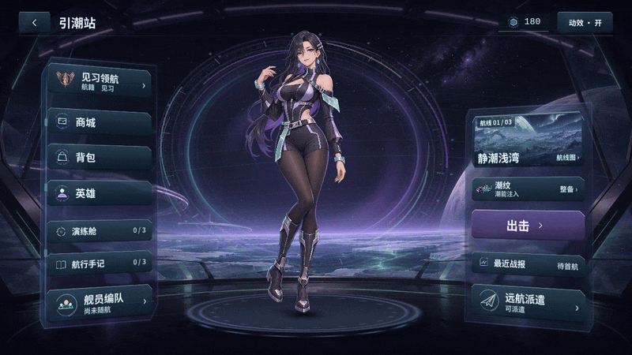
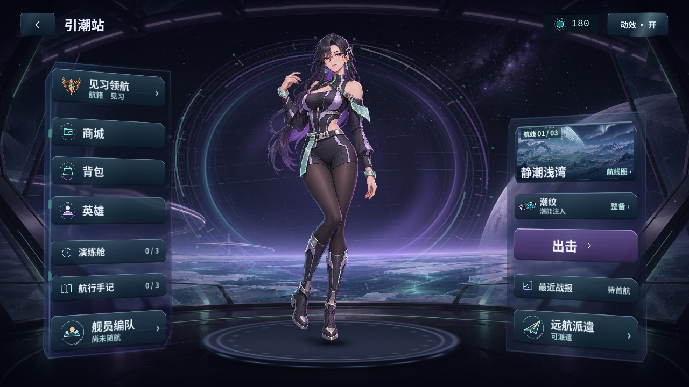
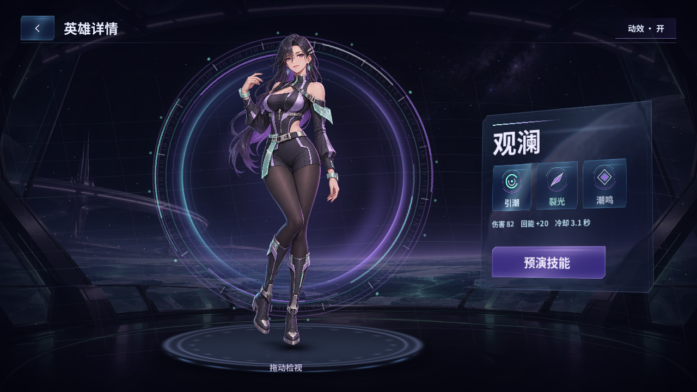

<div align="center">

<a href="docs/images/urui-icon.png"></a>

# URUI

**Build native Unity game interfaces with HTML and CSS.**

Keep layouts, styles and animation timelines in Git. The Unity workbench lets designers and AI agents inspect the same screen, edit its source and capture the result.

[Install Core](#install-core) · [Play the sample](#tideglass-beacon) · [Developer guides](#developer-guides) · [中文](README_ZH.md)

</div>

## Tideglass Beacon



Take command of an orbital station. Choose an escort, buy a module and take it into a beacon trial. Watch the crew cards tilt under the pointer and the bridge refract the scene behind its controls. Tideglass Beacon was made entirely by AI, including its design, code, original art, animation and sound. The recording above is from Unity Play Mode.

**Play the sample.** Clone or download the repository and open [SampleProject](SampleProject) in Unity **6000.3.22f1**. Choose **Tools → URUI → Open Tideglass Beacon Sample**, then press **Play**. Use **F1** to see rendering statistics. [Sample guide and controls](Packages/com.fujisheng.urui/Samples~/Tideglass%20Beacon/README.md)

<details>
<summary>View the station bridge and pilot dossier at full resolution</summary>

<p align="center">
  <a href="docs/images/tideglass-lobby.png"></a>
  <a href="docs/images/tideglass-hero.png"></a>
</p>

</details>

## Install Core

In Unity Package Manager, choose **Install package from git URL** and paste this address to install the Core runtime at **0.8.0-preview.1**.

```text
https://github.com/fujisheng/URUI.git?path=/Packages/com.fujisheng.urui#v0.8.0-preview.1
```

Core includes the controls, renderer and sample scenes. Add Effect for visual effects or Authoring for the editor workbench. The release includes a downloadable UPM package for each module. [Release and downloads](https://github.com/fujisheng/URUI/releases/tag/v0.8.0-preview.1) · [Installation guide](Packages/com.fujisheng.urui/Documentation~/INSTALL.md)

## What you can build

| Package | In your project |
| --- | --- |
| [**Core**](Packages/com.fujisheng.urui/README.md) | Lay out a HUD with HTML and CSS, wire typed controls to gameplay in C#, and reuse rows in long inventories. The native renderer draws a document through a Unity surface. [Core API](Packages/com.fujisheng.urui/Documentation~/REFERENCE.md) |
| [**Effect**](Packages/com.fujisheng.urui.effect/README.md) | Drive a wave gauge, dissolve a panel or trigger hit particles in sync with a skill animation. Style effects in CSS and animate their parameters. [Effect CSS](Packages/com.fujisheng.urui.effect/Documentation~/CSS.md) |
| [**Authoring**](Packages/com.fujisheng.urui.authoring/README.md) | Inspect the hierarchy and computed styles, scrub a timeline, or let an AI agent edit a document and capture a Unity preview through the local editor API. [Agent API](Packages/com.fujisheng.urui.authoring/Documentation~/agent-api.md) |

## Developer guides

| Goal | Guides |
| --- | --- |
| Build your first screen | [Getting started](docs/GETTING_STARTED.md) · [Supported HTML and CSS](docs/HTML_CSS_CHEATSHEET.md) · [AI authoring workflow](docs/AI_WORKFLOW.md) |
| Integrate the renderer | [Architecture](docs/ARCHITECTURE.md) · [URP and Built-in integration](docs/RENDER_PIPELINE_URP.md) · [Batching and memory](docs/PERFORMANCE_AND_MEMORY.md) |
| Work on the engine | [Build and test](docs/DEVELOPMENT.md) · [Code and assemblies](docs/CODE_ORGANIZATION.md) · [Third-party notices](Packages/com.fujisheng.urui/Third%20Party%20Notices.md) |

Core ships native plugins for macOS (Apple Silicon and Intel), Windows x64, Android (ARM64 and x86_64), iOS ARM64 and WebGL wasm32. The sample targets Unity **6000.3.22f1** with URP. [Platform verification matrix](Packages/com.fujisheng.urui/Documentation~/LIMITATIONS.md) · [Binary checksums](Packages/com.fujisheng.urui/Documentation~/PLUGINS.json)
