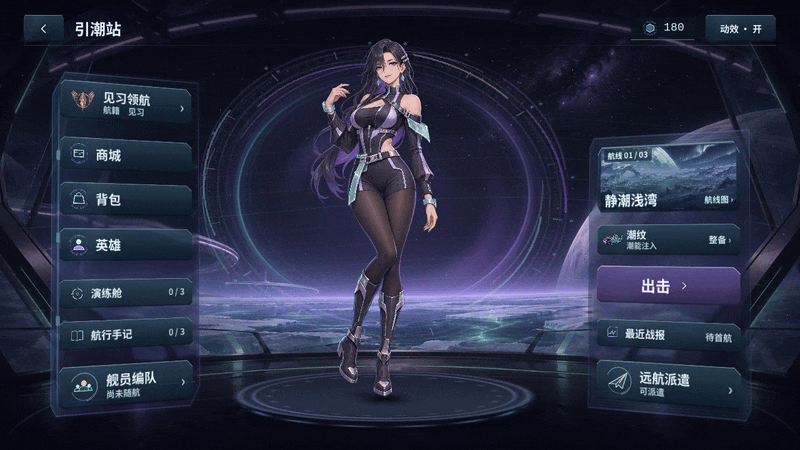
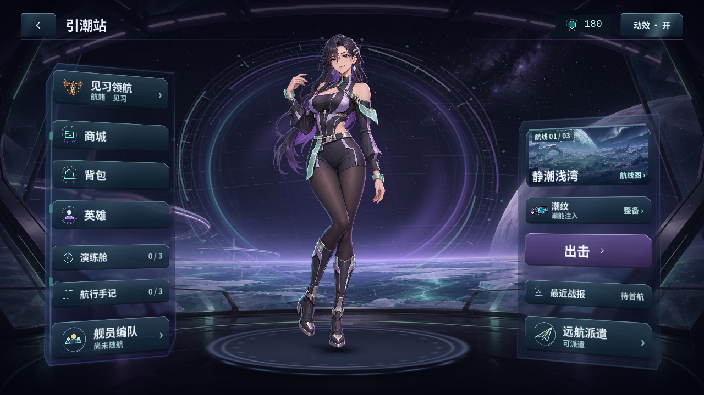

<div align="center">

<a href="docs/images/urui-icon.png"></a>

# URUI

**用 HTML 和 CSS 编写原生渲染的 Unity 游戏界面。**

布局、样式和动画时间线都可以在 Git 中审阅。设计师和 AI 都能通过 Unity 工作台检查同一块界面、修改源文件，再查看渲染结果。

[安装 Core](#安装-core) · [运行样例](#潮汐信标) · [开发文档](#开发文档) · [English](README.md)

</div>

## 潮汐信标



从引潮站挑选随航舰员，买下模组，再带着新配装挑战信标。移动指针时，舰员卡片跟着倾转，舰桥按钮背后的玻璃会折射场景。《潮汐信标》完全由 AI 制作，涵盖界面设计、代码、原创美术、动效和音效。上方动图录自 Unity Play Mode。

**在 Unity 中体验。** 克隆或下载仓库，用 Unity **6000.3.22f1** 打开 [SampleProject](SampleProject)，选择 **Tools → URUI → Open Tideglass Beacon Sample**，然后按 **Play**。运行时按 **F1** 可以查看渲染统计。[样例玩法与操作说明](Packages/com.fujisheng.urui/Samples~/Tideglass%20Beacon/README_ZH.md)

<details>
<summary>查看引潮站和英雄详情的高清画面</summary>

<p align="center">
  <a href="docs/images/tideglass-lobby.png"></a>
  <a href="docs/images/tideglass-hero.png"></a>
</p>

</details>

## 安装 Core

在 Unity Package Manager 中选择 **Install package from git URL**，粘贴下面的地址即可安装 **0.8.0-preview.1** 版 Core 运行时。

```text
https://github.com/fujisheng/URUI.git?path=/Packages/com.fujisheng.urui#v0.8.0-preview.1
```

Core 自带控件、渲染器和示例场景。需要视觉特效时可加装 Effect，需要可视化工作台时可加装 Authoring。发布页提供三个模块各自的 UPM 安装包。[版本说明与下载](https://github.com/fujisheng/URUI/releases/tag/v0.8.0-preview.1) · [安装指南](Packages/com.fujisheng.urui/Documentation~/INSTALL_ZH.md)

## 可以用它做什么

| 模块 | 游戏中的用途 |
| --- | --- |
| [**Core**](Packages/com.fujisheng.urui/README_ZH.md) | 用 HTML 和 CSS 排布战斗 HUD，用 C# 将控件接入玩法，或为长背包列表复用列表项。原生渲染器通过 Unity 中的 Surface 绘制界面文档。[Core API](Packages/com.fujisheng.urui/Documentation~/REFERENCE_ZH.md) |
| [**Effect**](Packages/com.fujisheng.urui.effect/README_ZH.md) | 让蓄能槽随波形起伏、面板溶解退场，或在技能命中时触发粒子。特效参数可以写进 CSS 并随时间线播放。[特效 CSS](Packages/com.fujisheng.urui.effect/Documentation~/CSS_ZH.md) |
| [**Authoring**](Packages/com.fujisheng.urui.authoring/README_ZH.md) | 检查层级和计算样式，拖动时间线预览动画，也可以让 AI 通过本机编辑器接口修改文档并截取 Unity 渲染结果。[Agent 接口](Packages/com.fujisheng.urui.authoring/Documentation~/agent-api_ZH.md) |

## 开发文档

| 要做的事 | 从这里开始 |
| --- | --- |
| 编写第一个界面 | [入门指南](docs/GETTING_STARTED_ZH.md) · [HTML 与 CSS 支持速查](docs/HTML_CSS_CHEATSHEET_ZH.md) · [AI 辅助编辑流程](docs/AI_WORKFLOW_ZH.md) |
| 接入渲染管线 | [引擎架构](docs/ARCHITECTURE_ZH.md) · [URP 与 Built-in 接入](docs/RENDER_PIPELINE_URP_ZH.md) · [合批与内存](docs/PERFORMANCE_AND_MEMORY_ZH.md) |
| 参与引擎开发 | [构建与测试](docs/DEVELOPMENT_ZH.md) · [源码与程序集](docs/CODE_ORGANIZATION_ZH.md) · [第三方许可](Packages/com.fujisheng.urui/Third%20Party%20Notices.md) |

Core 随包提供 macOS（Apple Silicon 与 Intel）、Windows x64、Android（ARM64 与 x86_64）、iOS ARM64 和 WebGL wasm32 的原生插件。样例使用 Unity **6000.3.22f1** 与 URP。[各平台验证范围](Packages/com.fujisheng.urui/Documentation~/LIMITATIONS_ZH.md) · [二进制校验清单](Packages/com.fujisheng.urui/Documentation~/PLUGINS.json)
