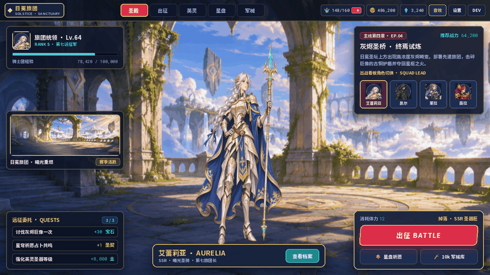
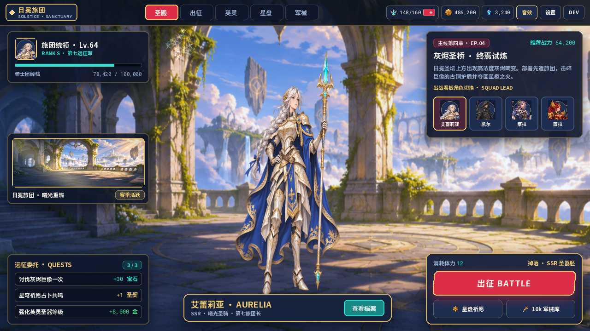
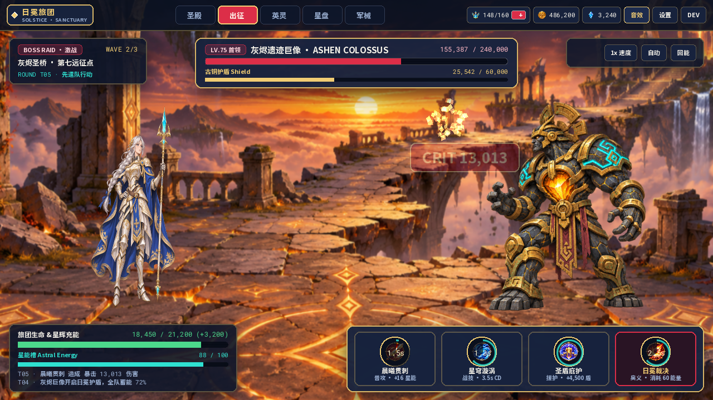

# URUI — 面向 Unity 的文本优先 HTML/CSS UI 引擎

[English](README.md) | **中文**

URUI 将 **标准 HTML、CSS 与文本驱动的时间线动画** 引入 **Unity 6（`6000.3.22f1`）**，底层采用 C++ 原生桥接库（`URUIBridge` ABI13 / render-plan9 / element4，172 个正式导出函数）、FreeType 字形光栅化、GPU 参数页合批渲染，彻底避免为每个 UI 节点创建 `GameObject / MonoBehaviour` 的传统开销。

> **交互式体验工程**：使用 Unity `6000.3.22f1` 直接打开 [`SampleProject/`](SampleProject)（完整展示 URP 3D 舞台融合 + Effect 特效 + Authoring），或在任意工程导入核心样例 [`Samples~/Solstice`](Packages/com.fujisheng.urui/Samples~/Solstice/README_ZH.md)。

---

## 核心特性

- **天然契合 AI 与文本 Diff**：界面结构、主题设计变量、交互状态与多轨动画序列全部使用可读文本（`.html` / `.css` / `.urui-sequence.json`），方便 Git 审阅、浏览器对照与 AI Agent 直接协作。
- **原生渲染计划与可控内存**：原生 C++ 端完成布局计算、有序渲染计划编译（`render-plan9`）、单批 8 纹理槽合批、不可变参数页上传及 GPU Fence 安全退役；稳态帧托管零 GC，并通过 `Surface.GetRenderingStatistics()` 在 Editor 与 Player 中实时观测渲染开销。
- **模块化三包设计**：
  - [**`com.fujisheng.urui`**（`0.8.0-preview.1`）](Packages/com.fujisheng.urui/README_ZH.md)：Core 运行时（`Surface`、`Document`、`Element`、全套类型化控件、万级虚拟列表 `ListView`、`CompiledDocumentAsset` 预编译字节码、`SequencePlayer`、`StaggeredReveal`、`BezierMotion`）。
  - [**`com.fujisheng.urui.effect`**（`0.5.0-preview.1`）](Packages/com.fujisheng.urui.effect/README_ZH.md)：CSS `--urui-fx-*` 滤镜、预设控制器 `EffectController`、声明式粒子 `<urui-particles>`、弧形文字 `ArcTextLayout`、`WaveEffect` 与离屏 `TextureEffectSurface`。
  - [**`com.fujisheng.urui.authoring`**（`0.1.0-preview.1`）](Packages/com.fujisheng.urui.authoring/README_ZH.md)：Editor 专属可视化检查器、源码树、动画时间轴与本机 HTTP Agent 接口 v1。

---

## SOLSTICE《日冕旅团》演示工程亮点

| 圣殿大厅与离屏 Shader 横幅 | 首领战与 Radial360 环形技能冷却 |
| --- | --- |
|  |  |

1. **高对比游戏感纯 CSS 主题**：通过 `@property` 可继承颜色变量一键切换 *夜曜靛蓝*、*烬火绯红* 与 *晨曦玉石*，冷色锐利 HUD 与暖金幻想原画清晰分离。
2. **战术 RPG 战斗与动效联动**：`Image.FillMode = Radial360` 技能冷却扇面、`SequencePlayer` 多轨召唤星盘动画与粒子星雨、`ui-wave` 波浪与 `ArcTextLayout` 弧形字带。
3. **10,000 件军械虚拟列表**：基于 `CompiledDocumentAsset` AOT 预编译资产秒开加载并实时筛选检索。
4. **URP RenderGraph 3D 透明合成**：[`UruiUrpRendererFeature`](SampleProject/Assets/Solstice/Runtime/Rendering/UruiUrpRendererFeature.cs) 将游戏 HUD 直接合成在 3D 视差景深背景之上。

---

## 快速上手

### 方式一：直接打开独立 URP Showcase 工程（`SampleProject/`）

1. 使用 **Unity `6000.3.22f1`** 打开仓库根目录的 `SampleProject/`。
2. 打开场景 `Assets/Solstice/Scenes/Solstice.unity` 并点击 **Play**。
3. 体验圣殿大厅、首领战、英灵 Shader 特效展示、星盘抽卡、万级军械库、主题设置与实时性能监控 HUD。

### 方式二：通过 UPM 本地接入任意项目

在 **Package Manager → Add package from disk...** 中选中 `Packages/com.fujisheng.urui/package.json`（按需安装 `effect` 与 `authoring`），通过顶部菜单 **Tools → URUI → Open Solstice Sample** 即可一键导入并运行基础样例。

详细配置流程见 [新手入门指南](docs/GETTING_STARTED_ZH.md)。

---

## 文档导航

### 全库技术指南（[English](docs/GETTING_STARTED.md) / 中文）

| 主题 | English | 中文 |
| --- | --- | --- |
| 安装与快速上手 | [GETTING_STARTED.md](docs/GETTING_STARTED.md) | [GETTING_STARTED_ZH.md](docs/GETTING_STARTED_ZH.md) |
| 整体架构与 `ABI13` 原生协议 | [ARCHITECTURE.md](docs/ARCHITECTURE.md) | [ARCHITECTURE_ZH.md](docs/ARCHITECTURE_ZH.md) |
| URP 与 Built-in 渲染管线集成 | [RENDER_PIPELINE_URP.md](docs/RENDER_PIPELINE_URP.md) | [RENDER_PIPELINE_URP_ZH.md](docs/RENDER_PIPELINE_URP_ZH.md) |
| 性能优化、合批与内存/显存防泄漏设计 | [PERFORMANCE_AND_MEMORY.md](docs/PERFORMANCE_AND_MEMORY.md) | [PERFORMANCE_AND_MEMORY_ZH.md](docs/PERFORMANCE_AND_MEMORY_ZH.md) |
| HTML 标签与 CSS 属性支持速查表 | [HTML_CSS_CHEATSHEET.md](docs/HTML_CSS_CHEATSHEET.md) | [HTML_CSS_CHEATSHEET_ZH.md](docs/HTML_CSS_CHEATSHEET_ZH.md) |
| AI 辅助工作流与实时编辑协议 | [AI_WORKFLOW.md](docs/AI_WORKFLOW.md) | [AI_WORKFLOW_ZH.md](docs/AI_WORKFLOW_ZH.md) |
| 原生构建、单元测试与研发规范 | [DEVELOPMENT.md](docs/DEVELOPMENT.md) | [DEVELOPMENT_ZH.md](docs/DEVELOPMENT_ZH.md) |
| 代码组织、目录职责与程序集边界 | [CODE_ORGANIZATION.md](docs/CODE_ORGANIZATION.md) | [CODE_ORGANIZATION_ZH.md](docs/CODE_ORGANIZATION_ZH.md) |

### 分包参考手册

- **Core 核心包 (`com.fujisheng.urui`)**：[README_ZH](Packages/com.fujisheng.urui/README_ZH.md) · [English README](Packages/com.fujisheng.urui/README.md) · [快速开始](Packages/com.fujisheng.urui/Documentation~/QUICK_START_ZH.md) · [API 参考](Packages/com.fujisheng.urui/Documentation~/REFERENCE_ZH.md)
- **Effect 特效包 (`com.fujisheng.urui.effect`)**：[README_ZH](Packages/com.fujisheng.urui.effect/README_ZH.md) · [English README](Packages/com.fujisheng.urui.effect/README.md) · [CSS 参数参考](Packages/com.fujisheng.urui.effect/Documentation~/CSS_ZH.md)
- **Authoring 编辑器包 (`com.fujisheng.urui.authoring`)**：[README_ZH](Packages/com.fujisheng.urui.authoring/README_ZH.md) · [English README](Packages/com.fujisheng.urui.authoring/README.md) · [Agent HTTP 接口](Packages/com.fujisheng.urui.authoring/Documentation~/agent-api_ZH.md)

---

## 原生平台与工具链支持

[`Packages/com.fujisheng.urui/Runtime/Plugins`](Packages/com.fujisheng.urui/Runtime/Plugins) 预置七个目标平台的同源编译产物（统一 `ABI13 / render-plan9 / element4`）：
`macOS ARM64`、`macOS x86_64`、`Windows x86_64`、`Android ARM64`、`Android x86_64`、`iOS ARM64（静态库）`、`WebGL wasm32（静态库）`。

Unity 验证基线版本为 `6000.3.22f1`。二进制清单与构建哈希见 [`PLUGINS.json`](Packages/com.fujisheng.urui/Documentation~/PLUGINS.json)，第三方开源许可说明见 [`Third Party Notices.md`](Packages/com.fujisheng.urui/Third%20Party%20Notices.md)。
